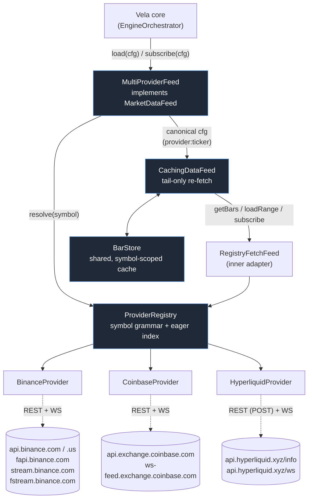

# Data Providers — Technical Report

This page is the internals companion to [`docs/user/data-providers.md`](../user/data-providers.md)
(how to *use* `chart.data`) and [`data-flow.md`](data-flow.md) (how the core turns loaded bars into
a rendered indicator). Here the subject is narrower and deeper: **how the market-data layer itself
is built** — the port, the registry, the cache, and the three bundled REST/WebSocket clients
(Binance, Coinbase, Hyperliquid).

Everything below is read directly from `src/core/ports/{DataProvider,MarketDataFeed}.ts`,
`src/data/{ProviderRegistry,MultiProviderFeed,CachingDataFeed,BarStore}.ts` and
`src/data/providers/{binance,coinbase,hyperliquid}/*`. Midorii kept this whole stack byte-identical
to upstream Vela (`git diff upstream/main -- src/data` is empty) and mirrors the same three venues
on its own Electron-side historical-download layer (`app/electron/data/providers/`).

## Layering



Five pieces, each with exactly one job:

| Layer | File | Job |
|---|---|---|
| `DataProvider` | `core/ports/DataProvider.ts` | The **port** — the contract one venue implements. |
| `ProviderRegistry` | `data/ProviderRegistry.ts` | Parses symbol strings, builds each provider's eager index, resolves a symbol to `{provider, ticker}`. |
| `MultiProviderFeed` | `data/MultiProviderFeed.ts` | The default `MarketDataFeed` the core talks to — routes through the registry, rewrites configs to a canonical `provider:ticker` form, owns the offline-`data` bypass. |
| `CachingDataFeed` | `data/CachingDataFeed.ts` | Decorates any `MarketDataFeed` with an in-memory closed-bar cache; turns a re-run into a tail-only fetch. |
| `BarStore` | `data/BarStore.ts` | The actual cache: one sorted, de-duplicated `OHLCV[]` per `(provider, symbol, timeframe, session)`, module-shared so it survives chart re-creation. |

## The `DataProvider` port

One required method, five optional ones — a provider can be as small as a single `getBars`:

```ts
interface DataProvider {
  getBars(ticker, timeframe, range): Promise<OHLCV[]>;      // required
  getBarsProgressive?(...);   // stream growing snapshots while backfilling a cold symbol
  info?(): ProviderInfo;      // display name, supported timeframes, capability flags
  listSymbols?(): Promise<SymbolDescriptor[]>;  // drives the eager index (autocomplete + bare-symbol routing)
  getSymbolInfo?(ticker): Promise<SymbolInfo | undefined>;   // Pine syminfo.* metadata
  resolveSymbolIcon?(descriptor): string | undefined;        // icon URL for pickers/legend/object-tree
  subscribe?(ticker, timeframe, onBar, opts?): Unsubscribe;  // true live push; absent ⇒ the feed polls getBars every 3s
  getCalendar?(ticker, range): Promise<[start, end][]>;      // market-open windows for session-aware chrome
  configure?(config): void;                                  // e.g. an API key
  capabilitiesFor?(ticker): ProviderCapabilities;             // per-instrument override of info().capabilities
}
```

Every optional member is a **progressive enhancement**: the registry and the feed check for its
presence and degrade around its absence rather than branching on provider identity. All three
bundled providers implement `getBars`, `info`, `listSymbols`, `getSymbolInfo`, `resolveSymbolIcon`
and `subscribe`; none implements `getBarsProgressive`, `getCalendar` or `configure` (crypto venues
need no API key and trade continuously, so a calendar has nothing to report).

## Symbol grammar and resolution (`ProviderRegistry`)

A raw symbol splits into an optional `provider:` prefix plus a ticker (`parseSymbol`,
`/^(?:([A-Za-z0-9_.]+):)?(.+)$/`). Resolution (`resolve(raw, opts)`) tries, in order:

1. **Explicit registered-provider prefix** — `BINANCE:BTCUSDT` always routes to the provider
   registered under that name, no index needed. If the resolved descriptor turns out to be a
   *group row* (a futures root like `ES`), it's translated to that group's default member.
2. **Listing-prefix routing** — a prefix that is *not* a provider name is matched against each
   provider's **declared** listing prefix for that ticker (`NASDAQ:AAPL`). This is strict: the
   verdict comes from the indexed data, never from string similarity, so `NYSE:AAPL` on a
   NASDAQ-only index resolves to nothing rather than auto-correcting.
3. **Bare symbol** — the first provider, in **registration order** (the caller's `opts.default`
   tried first), whose eager index contains the ticker.
4. **Lenient fallback** (primary chart load only) — if exactly one provider is registered and it
   declares no `listSymbols` (or enumeration failed), it's used optimistically: there's no index to
   consult, so the `getBars` call itself is the test.

A symbol that resolves to nothing **parks** rather than errors: `whenResolvable()` returns a
promise that stays pending, re-attempted on every registry change, until either a provider can
serve it or *every* registered provider's index has settled (only then is
`console.warn('[vela] symbol "X" not yet resolvable — …')` fired — reporting after the *first*
index would produce false negatives in a multi-provider setup).

Each provider's index is built **eagerly** at `registerProvider(...)` time from `listSymbols()`:
a `Set` of normalized tickers (bare resolution), a `Map` from `PREFIX:TICKER` to its descriptor
(listing-prefix resolution), and a `Map` from ticker to descriptor (canonical display spelling,
icon lookups). None of the three bundled providers declares a listing `prefix` on its descriptors
(crypto has no separate "listing venue" — the provider *is* the venue), so for Binance/Coinbase/
Hyperliquid symbols, step 2 above never fires; the provider name is the effective prefix.

## `MultiProviderFeed` — adapting the registry to `MarketDataFeed`

This is the concrete `MarketDataFeed` a fresh `Vela`/`VelaWorkspace` gets by default. Its `load`,
`loadRange` and `subscribe` all:

1. Resolve the raw symbol via the registry (`whenResolvable` for the primary load — parks until
   resolvable; plain `resolve` for secondary series, which fail closed to `[]`/no-op instead of
   parking).
2. Remember the primary chart symbol's resolved provider (`primaryProvider`) as the default for
   bare *secondary* symbols — so after the user switches venues, a script's un-prefixed
   `request.security` calls follow the chart onto the new venue instead of latching the first one
   ever resolved.
3. Rewrite the config to the **canonical** `provider:ticker` form and hand it to an internal
   `CachingDataFeed` wrapping a `RegistryFetchFeed` (a thin adapter that parses that canonical
   symbol back out and calls the resolved provider's neutral `getBars`/`subscribe`/`getBarsProgressive`).

Offline mode (`new Vela('#chart', { data: myBars })`) bypasses the registry entirely: `load`
returns the array as-is, and `subscribe` synthesizes plausible ticks (±0.15% price jitter, ~12%
chance per second of also opening a new bar) so the forming-candle rendering path is exercised
with no network at all.

`RegistryFetchFeed.subscribe` is also where the **generic poll fallback** lives for any provider
that doesn't implement `subscribe`: a 3-second interval calling `getBars(ticker, tf, {limit: 2})`
and re-emitting both bars (`onBar` dedupes by time, so the harmless older one is a no-op). It
re-checks a `stopped` flag *after* the await, specifically so an unsubscribe that races a market
switch can't push a stale market's bar into the new series.

## `CachingDataFeed` + `BarStore` — the caching layer

`BarStore` holds one sorted, de-duplicated `OHLCV[]` per cache key
`` `${provider}|${symbol}|${timeframe}${session ? '|'+session : ''}` ``, plus the earliest time
each series is *provably* covered back to (`coveredFrom` — tracked separately from "the first
cached bar's time", because that time is always at-or-after any `from` that was ever requested and
so can never itself prove coverage). It is **symbol-scoped**: `retainSymbol(sym)` purges every
other symbol's series on a genuine symbol change, except symbols a multi-chart workspace has
declared via `retain(symbols, owner)` (the union of every cell's declaration) — so a four-chart
grid's cells never evict each other's history. One instance, `sharedBarStore`, is module-level and
outlives chart re-creation on purpose: a re-run over the same symbol reuses what's already fetched.

`CachingDataFeed` decorates the inner feed with three request shapes:

- **`load` (first mount / re-run)** — if the cache already holds `≥ n-1` closed bars for the
  requested count `n`, only the **tail** since the last cached bar is fetched and merged; a cold or
  under-covered cache falls back to a full `load`, then caches every bar but the last (the last is
  always treated as the forming candle and never cached). The class's own accounting: a re-run
  saves roughly `⌈N/1000⌉ − 1` requests versus re-downloading everything, i.e. it's a no-op for a
  ≤1000-bar chart and pays off on deep history.
- **`loadRange` (secondary series / backward history chunks)** — three cache-aware shapes:
  *historical* (`to` strictly older than the cached tip — served from cache if provably covered,
  else fetched once and cached, since nothing that old can be a forming bar); *backward extension*
  (`from` reaches older than the recorded coverage — fetch only the missing **head**, never
  re-download the already-covered middle); *tail* (everything else — refresh from the last cached
  bar forward). A miss simply fetches, caches, and records the new coverage floor.
- **`loadProgressive`** — a cold load streams the inner feed's own progressive batches straight
  through (caching only the final answer, exactly like `load`); a cache-covered load just answers
  through `load` itself, since a warm chart has nothing left to stream.

Every ranged fetch funnels through one chokepoint, `fetchRange`, which does two things no
individual provider is trusted to do on its own: it always passes an **explicit `limit`** (so a
source that silently clips an unlimited request to a small default window can't quietly truncate a
wide date-bounded fetch), and it walks **backward in bounded pages of 10,000 bars**
(`PAGE_BARS`) for anything estimated larger than that, rather than trusting a provider to serve one
giant response.

## The three bundled providers

All three are from-scratch REST + WebSocket clients — **no third-party market-data SDK, no API
key** — and share the same shape almost line for line: a canonical-timeframe → native-interval
map, a `NATIVE_MINUTES` list used to pick the largest native sub-timeframe that evenly divides an
unsupported one (`selectSubTf`), a generic epoch-aligned `aggregate(sub, bucketMs)` bucketer, a
`dedupeSorted` pass (sort by open-time, last write per timestamp wins), a `getBars` that **never
rejects** (catches everything, logs `console.warn('[vela] <Venue>: failed to fetch …')`, and
returns `[]` so a bad symbol or network blip empties the chart instead of rejecting a parked
load), and a live-streaming state machine with the identical constants: a **15s stall watchdog**
(no candle within 15s of opening the socket ⇒ declare the stream non-delivering and fall back to
polling), a **2s reconnect backoff** on an unexpected close, and the same **3s poll** as the
generic fallback for anything with no native stream at all.

| | Binance | Coinbase | Hyperliquid |
|---|---|---|---|
| REST base | `api.binance.com/api/v3` (probed; falls back to `api.binance.us/api/v3`), futures `fapi.binance.com/fapi/v1` | `api.exchange.coinbase.com` | `api.hyperliquid.xyz/info` (single `POST`, body `{type, ...}`) |
| WS base | `stream.binance.com:9443` (spot) / `fstream.binance.com` (futures) | `ws-feed.exchange.coinbase.com` | `api.hyperliquid.xyz/ws` |
| Instruments | spot (`BTCUSDT`) + USDT-margined perpetuals (`BTCUSDT.P`) | spot only (`BTC-USD`) | USD-margined perpetuals (bare `BTC`) + spot pairs (`PURR/USDC`) |
| Native candle stream | yes — `<symbol>@kline_<interval>` single-stream WS URL, no subscribe frame | **no** — built from the `ticker` channel | yes — `{method:'subscribe', subscription:{type:'candle', coin, interval}}` |
| Pagination cap | 1000 candles/request | 300 candles/request | ~5000 candles **total** per interval — no true pagination, just a bounded window |
| History depth | deep (paginates backward/forward past the cap) | deep (paginates past the cap) | **recent-only**: ~3.5 days of 1m, ~7 months of 1h, daily back to listing — no deeper backfill exists |
| Symbol enumeration | `GET /exchangeInfo` (spot filtered `status==='TRADING'`, futures filtered `contractType==='PERPETUAL'`) | `GET /products` (filtered `status==='online' && !trading_disabled`) | `POST {type:'meta'}` (perps) + `POST {type:'spotMeta'}` (spot pairs), merged |
| Rate limiting | endpoint failover only (`.com`→`.us` probe via `/ping`) — see note below | dedicated `RequestGate`: max 4 concurrent, ≥120ms between request *starts*, retries a 429 up to 4× honoring `Retry-After` else `600ms·2^attempt + jitter` | none observed |
| Icon source | Ledger crypto-icon CDN, keyed by base asset (`baseOf()` in `symbol-base.ts`) | same | same |

### Binance — the forming-candle and pagination details

`getBars` picks the base URL per instrument class (spot goes through the cached/probed
`spotBase()`, futures always `fapi.binance.com`), maps the canonical timeframe to a native Binance
`interval` string when one exists, or aggregates from the largest native sub-interval that evenly
divides the request (e.g. a `180` request fetches `60` candles and folds three into one). Fetching
walks **forward** from an explicit `from` (chunking `1000` candles at a time, cursor = last
`closeTime + 1ms`) or **backward** from `to`/now when only a `limit` is given (cursor = earliest
`openTime − 1ms`, capped by a `Math.ceil(limit/1000)+5` guard against runaway loops). The REST
probe (`spotBase`) shares one in-flight promise across a concurrent burst of first calls, so a page
that fires several requests at once pings `/ping` exactly once, not once per caller.

### Coinbase — building candles from ticker ticks

Coinbase's Exchange API has no kline/candle WebSocket, so the live path is synthesized: the
`ticker` channel supplies price ticks, `onTick` opens a new provisional forming bar whenever a
tick's aligned bucket advances past the current one (`open=high=low=close=price`, volume `0`),
extends it with new highs/lows/close on later ticks in the same bucket, and a periodic **5-second
REST re-seed** (`LIVE_RESEED_MS`) pulls the authoritative last two bars to fix the open and volume
(which a tick stream can't supply) and correct any drift — the previous bar is only emitted as
"closed" on that reseed once the bucket has genuinely rolled over. Weekly/monthly candles don't
exist on the venue at all; they're folded from daily bars over UTC-Monday-aligned weeks /
calendar months (`weekStartUTC`/`monthStartUTC`), a separate code path from the numeric-minute
aggregation used for intraday timeframes. Every REST call funnels through the shared
`RequestGate`, which also exposes the `Response` so `candlesChunk`'s caller (indirectly) could read
pagination headers if a future change needed the trades cursor (`cb-after`) — noted in the class
doc comment but not exercised by the current candle path.

### Hyperliquid — bounded, real-time-first

There is no cursor/limit on `candleSnapshot` — only a `[startTime, endTime]` window, capped
server-side to roughly the most recent 5000 candles of that interval. A bar-count request is
translated into a start offset (`end − (limit+2)·intervalMs`) rather than paginated, and a
`from`-bounded range (the cache's tail-refresh path) is passed straight through. This makes
Hyperliquid structurally a *live/recent* venue: requesting more history than exists simply returns
whatever the window holds, with no genesis signal to distinguish "no more data" from "you asked for
too much." The WebSocket keeps an idle connection alive with an explicit **30-second ping** (Binance
and Coinbase rely on the browser answering protocol-level pings automatically; Hyperliquid's
server expects an app-level `{method:'ping'}` frame instead).

## Symbol icons

None of the three declares an icon store of its own — all route `resolveSymbolIcon` through the
shared `ledgerCryptoIconUrl(baseOf(descriptor))` helper in `data/symbol-base.ts`: `baseOf` reads
the base asset from the descriptor's `"BTC / USDT"`-shaped description (stripping a trailing
"Perpetual"), or failing that strips a common quote suffix off the raw ticker
(`USDT|USDC|USD1|USDS|BUSD|USD|EUR|PERP`); the URL is
`https://crypto-icons.ledger.com/<BASE>.png`. An empty base, a missing resolver, or a resolver that
throws all fall back to the shell's colored-initials badge — never an error.

## An observed inconsistency worth flagging

`src/data/providers/binance/RateGate.ts` implements a full per-IP limiter for the Binance trade
path — concurrency cap, a pre-emptive pause from `X-MBX-USED-WEIGHT-1M`, a 429 backoff, and a 418
"banned" fast-fail (`RateLimitError`) — and it has its own dedicated unit test
(`test/rate-gate.test.ts`). But **nothing imports it**: `BinanceProvider.ts`'s `getBars`/`fetchKlines`
path calls `fetch` directly with no gate in front of it, and the class's own doc comment describes
falling back `api.binance.com → api.binance.us` as its only defense. Rate-limit protection on
Binance today is therefore just the endpoint failover — `RateGate` is present, tested in isolation,
and currently orphaned (either a leftover from an earlier trades-based implementation, per its doc
comment's mention of `getTrades`, or work staged for a future wiring-in).

## Extensibility

The only thing "bundled" means here is "shipped as an importable subpath" — `chart.data` itself is
provider-agnostic. Registering zero providers and passing bars via the `data` option works with no
network at all; registering a custom `DataProvider` (implement `getBars`, add whichever optional
members make sense) plugs into exactly the same registry, cache, and resolution rules as the three
above. Multiple providers can be registered at once — the registration order (or an explicit
`opts.default`) is the only thing that decides which one wins for a bare, ambiguous symbol.

## What Midorii changed

Nothing, in this stack. `git diff upstream/main` is empty for every file discussed here — the port,
the registry, the cache, and all three providers are carried over verbatim. Midorii's own additions
sit *beside* this layer, not inside it: `app/renderer/providers/LocalArchiveProvider.ts` is an
additional `DataProvider` registered under `local:`, reading bars from Midorii's own on-disk archive
over Electron IPC instead of the network, and `app/electron/data/providers/` mirrors the same three
venues (Binance/Coinbase/Hyperliquid) again on the *download* side — separate REST clients used only
to fill that local archive, not the live chart feed.
